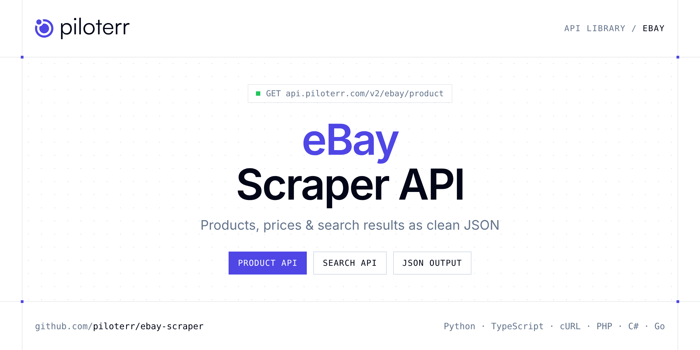

<p align="center">
  <a href="https://www.piloterr.com"></a>
</p>

# eBay Scraper API

[](https://discord.gg/CFj3ph8aHU) [](https://app.piloterr.com) [](https://app.piloterr.com/openapi) [](LICENSE)

The **Piloterr eBay Scraper API** lets you extract public data from eBay as **clean, structured JSON** — no proxies, headless browsers or HTML parsing to maintain. Endpoints available in production:

- **eBay Product API** — eBay Product API: one listing on a supported eBay site, by URL or item id (3 credits).
- **eBay Search API** — eBay Search API: search listings on supported eBay sites.

Use it for price monitoring, assortment tracking, competitor analysis, product research or catalog enrichment.

| Endpoint | Path | Credits | What you get |
|---|---|---|---|
| [eBay Product API](#ebay-product-api) | `/v2/ebay/product` | 3 | eBay Product API |
| [eBay Search API](#ebay-search-api) | `/v2/ebay/search` | 3 | eBay Search API |

## Table of contents

- [How it works](#how-it-works)
- [eBay Product API](#ebay-product-api)
- [eBay Search API](#ebay-search-api)
- [Code examples in other languages](#code-examples-in-other-languages)
- [Practical use cases](#practical-use-cases)
- [Why Piloterr?](#why-piloterr)
- [FAQ](#faq)
- [Related scrapers](#related-scrapers)
- [Support](#support)

## How it works

1. **Create a free Piloterr account** and copy your API key from the [dashboard](https://app.piloterr.com).
2. **Send a `GET` (or `POST`) request** to `https://api.piloterr.com/v2/...` with the header `x-api-key: YOUR_API_KEY`.
3. **Receive structured JSON** — Piloterr handles rendering, proxies, retries and parsing.

```bash
export PILOTERR_API_KEY="your-api-key"
pip install requests        # Python
# TypeScript: Node.js 18+ (native fetch), run with `npx tsx file.ts`
```

> Every endpoint accepts both `GET` (query string) and `POST` (JSON body with the same fields).

## eBay Product API

eBay Product API: one listing on a supported eBay site, by URL or item id (3 credits).

`GET | POST https://api.piloterr.com/v2/ebay/product` · **3 credits per request** · [Full reference](https://app.piloterr.com/openapi)

### Request parameters

| Parameter | Type | Required | Description |
|---|---|---|---|
| `query` | string | ✅ | Item id, or an item URL on a supported eBay site. |
| `return_page_source` | boolean | — | When true, return raw HTML. |

### Python example

```python
import json
import os
import requests

response = requests.get(
    "https://api.piloterr.com/v2/ebay/product",
    headers={"x-api-key": os.environ["PILOTERR_API_KEY"]},
    params={
        "query": "257758922911",
    },
    timeout=60,
)
response.raise_for_status()
data = response.json()

print(json.dumps(data, indent=2, ensure_ascii=False)[:2000])
```

### TypeScript example

```typescript
type EbayProduct = {
  mpn?: unknown;
  url?: string;
  gtin?: unknown;
  brand?: string;
  model?: string;
  price?: number;
  title?: string;
  images?: {
    url?: string;
    position?: number;
  }[];
  seller?: {
    name?: string;
    feedback?: string;
    thumbnail?: string;
    positive_feedback_percent?: number;
  };
  item_id?: string;
  returns?: {
    summary?: string;
    accepts_returns?: boolean;
  };
  currency?: string;
  shipping?: {
    summary?: string;
    ships_to?: string;
    handling_time?: unknown;
    seller_location?: unknown;
  };
  watchers?: number;
  condition?: string;
  image_url?: string;
  items_sold?: unknown;
  description?: unknown;
  availability?: string;
  is_best_offer?: boolean;
  is_buy_it_now?: boolean;
  price_display?: string;
  specifications?: {
    name?: string;
    value?: string;
  }[];
  payment_methods?: string[];
  quantity_available?: unknown;
  [key: string]: unknown;
};

const params = new URLSearchParams({
  "query": "257758922911",
});

const response = await fetch(`https://api.piloterr.com/v2/ebay/product?${params}`, {
  headers: { "x-api-key": process.env.PILOTERR_API_KEY! },
});
if (!response.ok) throw new Error(`Piloterr error ${response.status}: ${await response.text()}`);

const data = (await response.json()) as EbayProduct;

console.log(JSON.stringify(data, null, 2).slice(0, 2000));
```

<details>
<summary><b>POST variant</b></summary>

```http
POST https://api.piloterr.com/v2/ebay/product
x-api-key: YOUR_API_KEY
Content-Type: application/json

{"query": "257758922911"}
```
</details>

### Output example

Example response from the API reference, abridged — real values depend on the page you scrape.

```json
{
  "mpn": null,
  "url": "https://www.ebay.com/itm/336517253224",
  "gtin": null,
  "brand": "Dell",
  "model": "Dell Latitude 5520",
  "price": 399.99,
  "title": "Dell Latitude 5520 i5 15.6\" Touchscreen Laptop 16GB 512GB SSD Win 11 Pro",
  "images": [
    {
      "url": "https://i.ebayimg.com/images/g/~n4AAeSwxEBpXWER/s-l1600.png",
      "position": 1
    },
    {
      "url": "https://i.ebayimg.com/images/g/RPgAAOSwLcBieqIK/s-l1600.jpg",
      "position": 2
    }
  ],
  "seller": {
    "name": "AAA PCs Store",
    "feedback": "8442",
    "thumbnail": "https://i.ebayimg.com/images/g/hBUAAOSw6WZndu3y/s-l64.jpg",
    "positive_feedback_percent": 100
  },
  "item_id": "336517253224",
  "returns": {
    "summary": "30 days returns . Buyer pays for return shipping. If you use an eBay shipping label, it will be deducted from your refund amount . See de…",
    "accepts_returns": true
  },
  "currency": "USD",
  "shipping": {
    "summary": "May not ship to France. Read item description or contact seller for shipping options. See details for shipping Located in: Fort Myers, Fl…",
    "ships_to": "Varies",
    "handling_time": null,
    "seller_location": null
  },
  "watchers": 383,
  "condition": "Excellent - Refurbished",
  "image_url": "https://i.ebayimg.com/images/g/~n4AAeSwxEBpXWER/s-l1600.png",
  "items_sold": null,
  "description": null,
  "availability": "InStock",
  "is_best_offer": false,
  "is_buy_it_now": true,
  "price_display": "US $399.99",
  "specifications": [
    {
      "name": "Processor",
      "value": "Intel Core i5 11th Gen."
    },
    {
      "name": "Graphics Processing Type",
      "value": "Integrated/On-Board Graphics"
    }
  ],
  "payment_methods": [
    "PayPal",
    "Google Pay"
  ],
  "quantity_available": null
}
```

### Response fields

| Field | Type | Description |
|---|---|---|
| `mpn` | object |  |
| `url` | string |  |
| `gtin` | object |  |
| `brand` | string |  |
| `model` | string |  |
| `price` | number |  |
| `title` | string |  |
| `images[]` | object[] |  |
| `images[].url` | string |  |
| `images[].position` | integer |  |
| `seller` | object |  |
| `seller.name` | string |  |
| `seller.feedback` | string |  |
| `seller.thumbnail` | string |  |
| `seller.positive_feedback_percent` | integer |  |
| `item_id` | string |  |
| `returns` | object |  |
| `returns.summary` | string |  |
| `returns.accepts_returns` | boolean |  |
| `currency` | string |  |
| `shipping` | object |  |
| `shipping.summary` | string |  |
| `shipping.ships_to` | string |  |
| `shipping.handling_time` | object |  |
| `shipping.seller_location` | object |  |

## eBay Search API

eBay Search API: search listings on supported eBay sites. Returns price, seller, and pagination (3 credits).

`GET | POST https://api.piloterr.com/v2/ebay/search` · **3 credits per request** · [Full reference](https://app.piloterr.com/openapi)

### Request parameters

| Parameter | Type | Required | Description |
|---|---|---|---|
| `query` | string | ✅ | Keyword on www.ebay.com, or a search URL on a supported eBay site. |
| `page` | number | — | Page number, sent as _pgn. Default 1 for a keyword. On a URL, the page already in the URL is kept when this is empty. Below 1 returns 400. |
| `return_page_source` | boolean | — | When true, return raw HTML. |

### Python example

```python
import json
import os
import requests

response = requests.get(
    "https://api.piloterr.com/v2/ebay/search",
    headers={"x-api-key": os.environ["PILOTERR_API_KEY"]},
    params={
        "query": "laptop",
    },
    timeout=60,
)
response.raise_for_status()
data = response.json()

print(json.dumps(data, indent=2, ensure_ascii=False)[:2000])
```

### TypeScript example

```typescript
type EbaySearch = {
  results?: {
    url?: string;
    bids?: unknown;
    price?: number;
    title?: string;
    rating?: unknown;
    seller?: {
      name?: string;
      feedback?: string;
      positive_feedback_percent?: number;
    };
    item_id?: string;
    reviews?: unknown;
    currency?: string;
    location?: unknown;
    position?: number;
    shipping?: string;
    subtitle?: string;
    watchers?: unknown;
    condition?: string;
    image_url?: string;
    old_price?: number;
    price_max?: unknown;
    time_left?: unknown;
    items_sold?: number;
    buying_format?: string;
    is_best_offer?: boolean;
    price_display?: string;
    is_free_return?: boolean;
    is_new_listing?: boolean;
    [key: string]: unknown;
  }[];
  pagination?: {
    next?: string;
    page?: number;
    per_page?: number;
    total_pages?: unknown;
    total_results?: number;
  };
};

const params = new URLSearchParams({
  "query": "laptop",
});

const response = await fetch(`https://api.piloterr.com/v2/ebay/search?${params}`, {
  headers: { "x-api-key": process.env.PILOTERR_API_KEY! },
});
if (!response.ok) throw new Error(`Piloterr error ${response.status}: ${await response.text()}`);

const data = (await response.json()) as EbaySearch;

console.log(JSON.stringify(data, null, 2).slice(0, 2000));
```

<details>
<summary><b>POST variant</b></summary>

```http
POST https://api.piloterr.com/v2/ebay/search
x-api-key: YOUR_API_KEY
Content-Type: application/json

{"query": "laptop"}
```
</details>

### Output example

Example response from the API reference, abridged — real values depend on the page you scrape.

```json
{
  "results": [
    {
      "url": "https://www.ebay.com/itm/336517253224",
      "bids": null,
      "price": 399.99,
      "title": "Dell Latitude 5520 i5 15.6\" Touchscreen Laptop 16GB 512GB SSD Win 11 Pro",
      "rating": null,
      "seller": {
        "name": "aaa_pcs",
        "feedback": "8.4K",
        "positive_feedback_percent": 100
      },
      "item_id": "336517253224",
      "reviews": null,
      "currency": "USD",
      "location": null,
      "position": 31,
      "shipping": "Shipping not specified",
      "subtitle": "Dell",
      "watchers": null,
      "condition": "Excellent - Refurbished",
      "image_url": "https://i.ebayimg.com/images/g/~n4AAeSwxEBpXWER/s-l140.webp",
      "old_price": 474.99,
      "price_max": null,
      "time_left": null,
      "items_sold": 299,
      "buying_format": "Buy It Now",
      "is_best_offer": false,
      "price_display": "$399.99",
      "is_free_return": false,
      "is_new_listing": false
    }
  ],
  "pagination": {
    "next": "https://www.ebay.com/sch/i.html?_nkw=laptop&_ipg=60&_pgn=2",
    "page": 1,
    "per_page": 60,
    "total_pages": null,
    "total_results": 190000
  }
}
```

### Response fields

| Field | Type | Description |
|---|---|---|
| `results[]` | object[] |  |
| `results[].url` | string |  |
| `results[].bids` | object |  |
| `results[].price` | number |  |
| `results[].title` | string |  |
| `results[].rating` | object |  |
| `results[].seller` | object |  |
| `results[].item_id` | string |  |
| `results[].reviews` | object |  |
| `results[].currency` | string |  |
| `results[].location` | object |  |
| `results[].position` | integer |  |
| `results[].shipping` | string |  |
| `results[].subtitle` | string |  |
| `results[].watchers` | object |  |
| `results[].condition` | string |  |
| `results[].image_url` | string |  |
| `results[].old_price` | number |  |
| `results[].price_max` | object |  |
| `results[].time_left` | object |  |
| `results[].items_sold` | integer |  |
| `results[].buying_format` | string |  |
| `results[].is_best_offer` | boolean |  |
| `results[].price_display` | string |  |
| `results[].is_free_return` | boolean |  |

## Code examples in other languages

Ready-to-run examples live in the [`examples/`](examples) folder. Each one reads your key from the `PILOTERR_API_KEY` environment variable.

| Language | Product | Search |
|---|---|---|
| cURL (Bash) | [`product`](examples/curl/product.sh) | [`search`](examples/curl/search.sh) |
| PHP | [`product`](examples/php/product.php) | [`search`](examples/php/search.php) |
| C# | [`product`](examples/csharp/Product.cs) | [`search`](examples/csharp/Search.cs) |
| Go | [`product`](examples/go/product.go) | [`search`](examples/go/search.go) |
| Java | [`product`](examples/java/ProductExample.java) | [`search`](examples/java/SearchExample.java) |
| Ruby | [`product`](examples/ruby/product.rb) | [`search`](examples/ruby/search.rb) |
| Node.js | [`product`](examples/nodejs/product.mjs) | [`search`](examples/nodejs/search.mjs) |

## Practical use cases

- **Price monitoring** — Track prices, promotions and availability over time to react to competitors.
- **Assortment & catalog tracking** — Follow new products, delisted items and category changes.
- **Competitor analysis** — Benchmark ranges, brands and positioning across retailers.
- **Product research** — Spot best-sellers and trends from search results.
- **Catalog enrichment** — Pull titles, images and attributes into your PIM or marketplace listings.

## Why Piloterr?

- **No infrastructure** — no proxies, headless browsers or CAPTCHA solving to run yourself.
- **Structured JSON** — stable, documented fields instead of brittle HTML selectors.
- **Pay per request** — transparent credit cost per endpoint, failed requests are retried for you.
- **One API key, hundreds of sources** — eBay plus many other e-commerce, search and company data endpoints in the [Piloterr library](https://www.piloterr.com/library).
- **Any language** — plain HTTPS + JSON, with examples for Python, TypeScript, cURL, PHP, C#, Go, Java, Ruby and Node.js.

## FAQ

### Is it legal to scrape eBay?

Collecting publicly available data is generally allowed in many jurisdictions, but rules depend on your country, the data you collect and how you use it. Avoid personal data unless you have a lawful basis, respect the website's terms where they apply, and get legal advice for your specific use case. This is not legal advice.

### Do I need proxies or a headless browser?

No. Piloterr handles rendering, proxy rotation and retries on its side. You only send an HTTPS request with your `x-api-key` header and receive JSON.

### How much does a request cost?

Credits per call: `/v2/ebay/product` **3**, `/v2/ebay/search` **3**. See the [Piloterr website](https://www.piloterr.com) for plans.

### What data does the eBay API return?

Each endpoint returns structured JSON: **eBay Product** — `mpn`, `url`, `gtin`, `brand`, `model`, `price`; **eBay Search** — `results[]`, `results[].url`, `results[].bids`, `results[].price`, `results[].title`, `results[].rating`.

### How do I paginate eBay results?

Use the `page` parameter and keep requesting while the response indicates more results.

### Can I get the raw HTML instead of JSON?

Yes. Set `return_page_source=true` and the response becomes `{"result": "..."}` with the page source.

### Which languages are supported?

Any language that can make an HTTP request. This README shows Python and TypeScript; the [`examples/`](examples) folder contains cURL, PHP, C#, Go, Java, Ruby and Node.js.

## Related scrapers

- [About You Scraper API](https://github.com/piloterr/aboutyou-scraper)
- [Action Scraper API](https://github.com/piloterr/action-scraper)
- [Aldi Scraper API](https://github.com/piloterr/aldi-scraper)
- [Alibaba Scraper API](https://github.com/piloterr/alibaba-scraper)
- [AliExpress Scraper API](https://github.com/piloterr/aliexpress-scraper)
- [Allegro Scraper API](https://github.com/piloterr/allegro-scraper)
- [All Piloterr scrapers on GitHub](https://github.com/piloterr)

## Support

- 💬 Join the [Piloterr Discord](https://discord.gg/CFj3ph8aHU) to ask questions and share what you build.
- 📚 Browse the [API reference (OpenAPI)](https://app.piloterr.com/openapi) and the [Piloterr library](https://www.piloterr.com/library).
- 🔑 [Get your API key](https://app.piloterr.com).

---

<p align="center">
  <a href="https://www.piloterr.com">
    <picture>
      <source media="(prefers-color-scheme: dark)" srcset="images/logo-dark.svg">
      
    </picture>
  </a>
  <br>
  <sub>Built by <a href="https://www.piloterr.com">Piloterr</a> — web scraping APIs for e-commerce, search, real estate and more, one API key.</sub>
</p>

<sub>eBay is a trademark of its respective owner. This repository is not affiliated with or endorsed by eBay. Examples are released under the MIT license.</sub>
